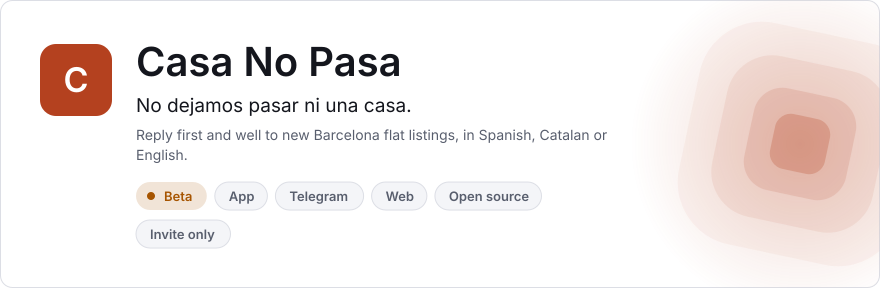
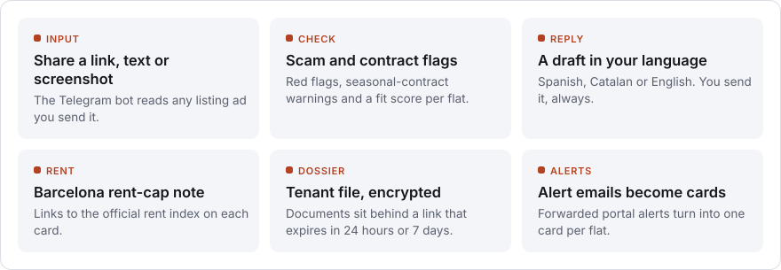
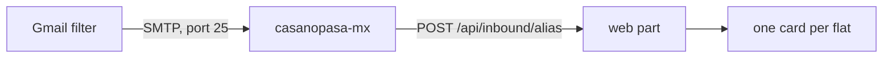

<!-- Pictures: docs/readme/spec.json, drawn by readme-kit. Do not edit the SVGs by hand. -->
<picture><source media="(prefers-color-scheme: dark)" srcset="docs/readme/hero-dark.svg"></picture>

**Share a flat ad and, within a minute, get a verdict and a reply ready to send.**

The tool says whether the ad looks like a real long-term flat, whether it fits your filters and which red flags it carries.
You send the reply, always: it never sends, applies or pays. Built: the engine, the Telegram bot, the dossier page and the
inbound-email endpoint with its SMTP receiver. Access is by invitation only, and nothing runs until the owner deploys it
and registers the webhook.

[Docs](docs/PLAN.md) · [Privacy](docs/PRIVACY.md) · [Architecture](docs/ARCHITECTURE.md) · [Licence](LICENSE)

## What it does

<picture><source media="(prefers-color-scheme: dark)" srcset="docs/readme/highlights-dark.svg"></picture>

- **Card buttons.** Open (the ad), WhatsApp and Copy for the draft; Español, Català and English to redraft.
- **Track what happened.** Sent, Viewing and Not for me record the outcome.
- **Flexible invites.** A renter can send a bare invite code, the whole invite link or the t.me link.
- **Revocable dossier.** `/dossier` shares the profile and chosen documents; `/revoke` switches off every link.
- **Delete anything.** `/delete` erases everything the bot stores. Listings and events are purged after 90 days.

## How it works

<picture><source media="(prefers-color-scheme: dark)" srcset="docs/readme/steps-dark.svg"></picture>

<details>
<summary>First run: what a renter sees</summary>

1. The renter opens the invite link and accepts the privacy notice. No questions follow.
2. The bot creates a profile with only the Telegram first name (it asks for a name only when Telegram sends none).
3. It sends one intro line, an example card and "Send me any listing". The example is a made-up flat run through
   the real assessment and the template draft: no AI call, nothing stored, no buttons.
4. After the first real card the bot offers once: "Want the reply to sound like you?" with Start (the optional
   questionnaire, from occupation onward) and Later. `/profile` and `/filters` edit everything at any time.

</details>

## Quick start

Owner:

```
1. Create a bot with @BotFather; copy its token and username into .env (see .env.example).
2. Fill the rest of .env, and the same values in the droplet's /srv/casanopasa/.env (deploy/droplet/.env.example).
3. ./scripts/deploy.sh
4. npm run telegram-setup        # webhook + command menus; add -- --check to see what is missing
5. npm run invite -- --remote    # prints a code and a t.me link; send it to the renter
```

Developers:

```
npm ci && cp .env.example .env && ./check.sh
npm run dev                     # the web part on :3000
```

Without the accounts-hub variables the AI is off: extraction uses rules and replies use templates.

## Commands

| Command | What it does |
|---|---|
| `/profile`, `/filters` | Edit the profile and the filters that decide each verdict |
| `/docs` | Upload documents |
| `/dossier` | Create a page with the profile and chosen documents; the link expires after 24 hours or 7 days |
| `/revoke` | Switch off every dossier link |
| `/email` | Get a personal address for alert emails |
| `/delete` | Erase everything the bot stores about the renter |
| `/help`, `/cancel` | Help; cancel the current step |

Documents are encrypted at rest (AES-256-GCM).

## Alert emails

Idealista, Fotocasa, Habitaclia and Pisos.com send saved-search alerts by email. One email often lists several
flats; each flat becomes its own card (at most 10 per email).

What the renter does:

1. Send `/email` to the bot. It replies with a personal address, `<32 hex characters>@in.casanopasa.fabriquefutur.com`.
2. In Gmail, add that address under Settings > Forwarding and POP/IMAP > Add a forwarding address. Gmail sends a
   confirmation email to it; the bot relays that email, with the code, to the chat. Enter the code in Gmail.
3. Create a filter with `from:(idealista.com OR fotocasa.es OR habitaclia.com OR pisos.com)` and the action
   "Forward it to" that address.



The `casanopasa-mx` service (`src/mx/server.ts`, the same image as the web part, host port 25) accepts only that address
pattern and POSTs `{from, subject, text, html?}` to `/api/inbound/<alias>` with the `x-casanopasa-inbound` secret.
It has no AUTH, never relays and never sends mail; messages over 2 MB are refused. Bodies and addresses are never logged.

<details>
<summary>Owner setup and local check for alert emails</summary>

Set `CASANOPASA_INBOUND_SECRET` in the droplet's `.env`, run `./scripts/deploy.sh` (it builds
`dist/droplet/app/mx.mjs`, re-renders the compose file and starts both services), open port 25 on the server, and add the
DNS record `MX in.casanopasa.fabriquefutur.com -> casanopasa.fabriquefutur.com (priority 10)`.

Local check:

```
npm run build:mx && MX_PORT=2525 CASANOPASA_APP_URL=http://localhost:3000 CASANOPASA_INBOUND_SECRET=... node dist/droplet/app/mx.mjs
```

</details>

<details>
<summary>What is where in the code</summary>

- `src/core/schema.ts`: the engine contract. `src/engine/`: extraction, assessment, drafts, SQLite store, `createEngine().handleInput`.
- `src/bot/`: Telegram client, webhook handler, first-run welcome, optional profile questions, listing cards, strings (en, es, ru).
- `src/server/`: encrypted files, dossier grants, runtime wiring. `app/`: webhook, dossier page, inbound email, landing, privacy.
- `deploy/droplet/`, `scripts/deploy.sh`: the shared droplet. `src/mx/`: the inbound SMTP receiver for alert emails.

</details>

## Docs

| Document | What is in it |
|---|---|
| [`docs/PLAN.md`](docs/PLAN.md) | Product, decisions D1-D6, security and privacy |
| [`docs/PRIVACY.md`](docs/PRIVACY.md) | What is stored |
| [`docs/ARCHITECTURE.md`](docs/ARCHITECTURE.md) | Modules and data flow |
| [`CONTRIBUTING.md`](CONTRIBUTING.md) | How to contribute |

## Licence

Apache-2.0, see [`LICENSE`](LICENSE).

<sub>Built by <a href="https://github.com/zaitsew">zaitsew</a> with a fleet of AI agents.</sub>

<!-- teyla:reviewed 2026-11-13 -->
